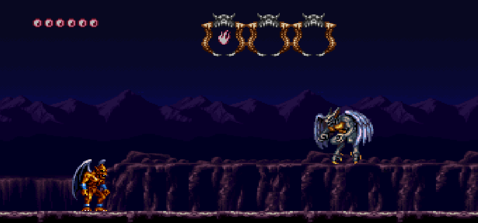
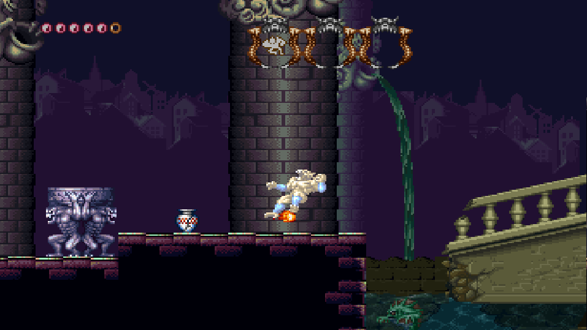
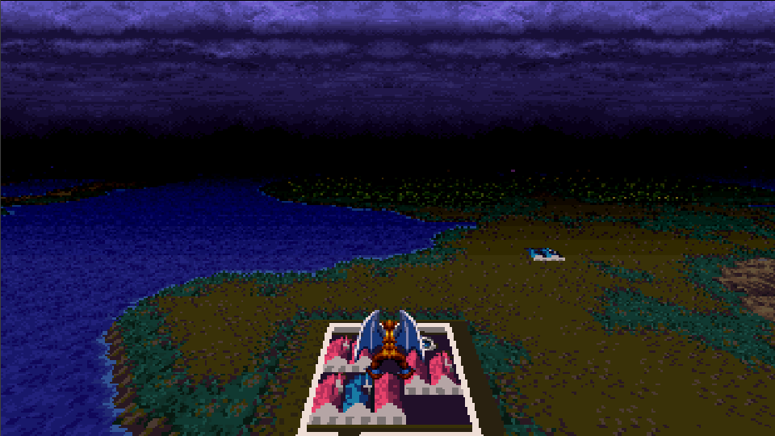

# Demon's Crest Recompiled

Native PC recompilation of **Demon's Crest** (USA), built on
[snesrecomp](https://github.com/magnopaz/snesrecomp). The 65816 game
code is translated to C and runs on the framework's authoritative interpreter,
while the SNES hardware — PPU, APU/SPC700, DMA/HDMA and cartridge mapping — is
emulated. Same model as N64Recomp and similar projects: recompile the CPU,
emulate the silicon.

Play with **adaptive widescreen**, save states, rewind and the shared launcher,
using your own legally dumped ROM.

[Quick start](#quick-start-build-from-source) |
[Features](#features) |
[Widescreen](#widescreen) |
[Build](#build) |
[Run](#run)

<table>
  <tr>
    <td width="50%" align="center">
      
      <br><strong>Widescreen gameplay</strong><br>The expanded field keeps the action and the HUD in view.
    </td>
    <td width="50%" align="center">
      
      <br><strong>Full-stage widescreen</strong><br>Backgrounds, sprites and effects extend into the margins.
    </td>
  </tr>
</table>

<p align="center">
  
  <br><strong>Mode 7 overworld</strong><br>The flying map fills the widened field, margins included.
</p>

> **You must legally own a copy of the game.** No ROM data is distributed with
> this project, in the repository or in any release. The recompiled C is
> generated locally from your own copy and is never committed.

## Status

The port boots and plays: the Capcom logo, intro, stage gameplay and boss
fights all run from the generated C. The native **Widescreen** mod is
implemented and validated through its final phase — background margins,
objects and sprites, HUD anchoring, the Mode 7 overworld, the top-band flicker
and save-state round-trips — with the engineering notes and validation summary
in [`docs/PORTING_NOTES.md`](docs/PORTING_NOTES.md).

Playtesting continues; general gameplay bugs and broader coverage are the
remaining work, so treat a full-game playthrough as not yet certified.

## Features

| Available | Feature | What it adds |
|:---------:|---------|--------------|
| &#9745; | **Adaptive widescreen** | Native widened field with adaptive, 16:9, 21:9 and 32:9 views. Disabled by default; with it off the game renders at the original 256-pixel width. |
| &#9745; | **Save states** | Ten slots (`F1`–`F10` load, `Shift+F1`–`Shift+F10` save) plus the save-state browser (`F11`). Legacy and current-format saves load in a fresh process. |
| &#9745; | **Rewind** | Rewind history (`F12`) over the shared framework's snapshot ring. |
| &#9745; | **Launcher** | `recomp-ui` ROM picker with a verification badge, display/audio/input settings and the Mods screen. |
| &#9745; | **ROM verification** | The ROM is checked against the project digests before anything boots; a mismatched dump is refused instead of mis-executing. |
| &#9745; | **Authentic 4:3** | The original 256-pixel field and layer layout remain the default when the widescreen mod is off. |

## Widescreen

Enable **Widescreen** in the launcher's **Mods** screen and pick a view:
**Adaptive**, **16:9** (342 px), **21:9** (448 px) or **32:9** (682 px). The
mod is off by default.

What it does:

- renders the game directly into the widened field (`native_widescreen`), so
  the scrolling backgrounds continue into symmetric margins;
- gates widening to stage gameplay (`$8D` in 1..0x7F, or the Mode 7 overworld
  map with its alternate-HUD variant): menus, cutscenes, password and
  transitional screens stay pillarboxed;
- widens the object-loop cull and the OAM emitter so enemies and effects just
  outside the native view keep updating and appear in the margins, and widens
  the attack projectile's on-screen test so shots fly across the whole field;
- anchors the BG3 status bar to the widened left edge and leaves the freed
  columns transparent, showing the scenery where the bar used to sit; BG3 is
  widened only on the bar's scanlines, so a dialogue box on the same layer
  keeps its native columns;
- keeps the Start/status menu pillarboxed (`$00FB` marks it): it is a
  full-screen native UI, and widening it would show the stage tilemap in the
  margins;
- drops the game's forced-blank upload cover from the raster replay in every
  scene (a field that stays blank keeps its black), which removes the black
  band that flickered at the top and lets HDMA tables start at the top of the
  field, keeping window effects aligned with their targets;
- keeps dialogue boxes and edge windows intact: the fixed-color box cannot
  leak a strip into the top-left corner, and a parked one-pixel layer window
  moves with the widened edge instead of cutting a one-pixel seam at the
  margin boundary;
- opens the Mode 7 overworld map to the widened field; the terrain continues
  into the margins with no renderer change.

The generated-code hooks are applied by
[`tools/dc_apply_widescreen_hooks.py`](tools/dc_apply_widescreen_hooks.py), an
idempotent injector run by `tools/regen.sh` and by the build. At margin 0 every
injected expression evaluates to the authentic constant, so the object and
sprite hooks add nothing to the 4:3 path.

Diagnostic kill-switches for A/B captures:
`SNESRECOMP_WS_OAM=0` (object/sprite widening),
`SNESRECOMP_WS_HUD=0` (status-bar anchoring),
`SNESRECOMP_WS_NOBLANK=0` (upload-cover policy),
`SNESRECOMP_WS_CULL=<px>` (cap the margin object window; 0 = authentic cull)
and `SNESRECOMP_WS_EXTRA=<px>` (fixed margin).

## Quick start (build from source)

1. Clone with the framework and launcher submodules:
   ```sh
   git clone --recurse-submodules https://github.com/magnopaz/DemonsCrestSNESRecomp.git
   cd DemonsCrestSNESRecomp
   ```
2. Have your own **Demon's Crest (USA)** ROM available. Keeping it outside the
   repository is the better habit; `SNESRECOMP_ROM` sets the path once for a
   shell.
3. Generate the recompiled C from the ROM:
   ```sh
   bash tools/regen.sh --rom "/path/to/Demon's Crest (USA).sfc"
   ```
4. Configure and build:
   ```sh
   cmake -S . -B build -DCMAKE_BUILD_TYPE=Release
   cmake --build build -j
   ```
5. Run:

   ```sh
   ./build/DemonsCrestSNESRecomp
   ```

   The launcher asks for the ROM on the first run and caches the choice.

On Windows with the MinGW toolchain, `tools/play.ps1` wraps regeneration,
configuration, build and launch in one step.

## Build

The default desktop backend is SDL3 (fetched and built from source when no
package is installed). To build against an installed SDL2 development package
instead — for example the MinGW one at `M:\SDL` on Windows:

```sh
cmake -S . -B build -G Ninja -DCMAKE_BUILD_TYPE=Release \
  -DSNESRECOMP_SDL_BACKEND=SDL2 \
  -DSDL2_DIR="M:/SDL/SDL2-2.32.6/x86_64-w64-mingw32/lib/cmake/SDL2"
```

`tools/play.ps1` automates regen + configure + build + launch for the Windows
MinGW toolchain (CMake, Ninja, GCC, Rust GNU, SDL2 under `M:\SDL`). It refuses
to build while a game instance is running (a forced kill would end that
session with no exit report); pass `-KillRunning` to terminate it explicitly.

The ROM does not have to live in the repository — `SNESRECOMP_ROM` sets the
path for a shell. Without it, `tools/regen.sh` looks for
`Demon's Crest (USA).sfc` at the repo root, then for the path the setup wizard
recorded in `rom.cfg`; `.gitignore` blocks both from ever being committed.

`tools/regen.sh` verifies the ROM, generates `src/gen/*.c`, and re-syncs
`recomp/funcs.h`. Re-run it whenever you change anything under `recomp/`.

## Run

```sh
./build/DemonsCrestSNESRecomp
# or name the ROM and skip the launcher
./build/DemonsCrestSNESRecomp "/path/to/Demon's Crest (USA).sfc"
```

With no ROM on the command line the build opens the `recomp-ui` launcher: a ROM
picker with a verification badge, display/audio/input settings and the Mods
screen. Your choice is cached in `rom.cfg` beside the executable, so the next
launch opens on it and "Skip launcher on boot" makes it immediate. If the
launcher is not built in (`--no-recomp-ui`), the host falls back to a native
file picker.

Either way the ROM is checked against the digests below before anything boots —
a dump that could not have produced this build is refused at the door rather
than mis-executing ten frames in.

During play: `F11` opens the save-state browser and `F12` opens rewind; both
pause gameplay while you choose. Hotkeys, controller mappings and pixel/aspect
options live in the launcher.

## ROM identity

| | |
|---|---|
| File | `Demon's Crest (USA).sfc` |
| Publisher | Capcom |
| Developer | Capcom |
| Year | 1994 |
| Mapping | lorom |
| Region | USA (North America) |
| Coprocessor | none |
| CRC32 | `e8236ad2` |
| SHA-256 | `18d40a807d5f88c5b6a1ad849eec7e0f189225d9a1586037c850f6680b5844de` |

`tools/regen.sh` refuses to run against anything else, so a mismatched revision
fails immediately instead of producing subtly wrong output.

## How the recompilation works

The 65816 CPU code from the ROM is statically translated to C — every function
the analysis can prove is a real generated C function in `src/gen/`. Execution
is **LLE-first**: an authoritative 65816 interpreter is the correctness floor,
and the statically compiled bodies are exact, proven materializations on top of
it — anything the static pass cannot prove keeps running through the
interpreter, loudly. The rest of the SNES is not recompiled: PPU rendering, the
APU/SPC700, DMA/HDMA, hardware register I/O and bank mapping run through
`snesrecomp`'s runner implementations.

Rules for contributors:

1. Never edit `src/gen/` by hand and never synthesise a result to get past
   uncovered code. Fix the config or the framework and regenerate.
2. Name routines in `recomp/symbols.toml`, then re-run `tools/regen.sh`. Set
   `emit = true` to promote a routine into ahead-of-time analysis; leave it
   false to keep it interpreted. Only proven variants become AOT code. See
   [`recomp/README.md`](recomp/README.md).
3. Deal with unresolved indirect dispatch targets before anything else — they
   are the reason a port diverges.

## Layout

| Path | What lives there |
|---|---|
| `recomp/` | Analysis input: `bank*.cfg`, `symbols.toml`, generated `funcs.h` |
| `rom_identity.txt` | ROM digests — read by the build, `tools/regen.sh` and CI |
| `src/` | Host code you own: `main.c`, `game_rtl.c`, widescreen policy |
| `src/gen/` | Generated C. Never committed — regenerate locally |
| `docs/` | `PORTING_NOTES.md` — verified state, fixes and roadmap |
| `mods/` | Preloaded mod catalog (the widescreen package) |
| `tools/` | `regen.sh`, `play.ps1` and the widescreen code injector |
| `snesrecomp/` | Framework submodule (owns `lib/recomp-net`, `lib/retcomm-rbengine`) |
| `recomp-ui/` | Shared launcher UI submodule |
| `scripts/` | `package_release.sh` — player-facing zip |
| `framework_pins.txt` | Exact framework commits this project was scaffolded against |

## Reporting problems

Open an issue with the build, the enabled mods and the steps to reproduce the
problem. For gameplay bugs, attach the save state (`build/saves/saveN.sav`)
and describe the inputs that trigger it. If the game closes unexpectedly,
also attach `last_run_report.prev.json` (the previous run's report, preserved
on the next launch) and any `crash_report_*.json` / `crash_minidump_*.dmp`
from the build directory.

[github.com/magnopaz/DemonsCrestSNESRecomp/issues](https://github.com/magnopaz/DemonsCrestSNESRecomp/issues)

## License

This project's own source is under the MIT license in [`LICENSE`](LICENSE).
The framework and launcher carry their own terms — see `snesrecomp/LICENSE`,
`snesrecomp/THIRD_PARTY_ATTRIBUTION.md` and `recomp-ui/LICENSE`. Neither
covers the game data, which is not distributed here.
